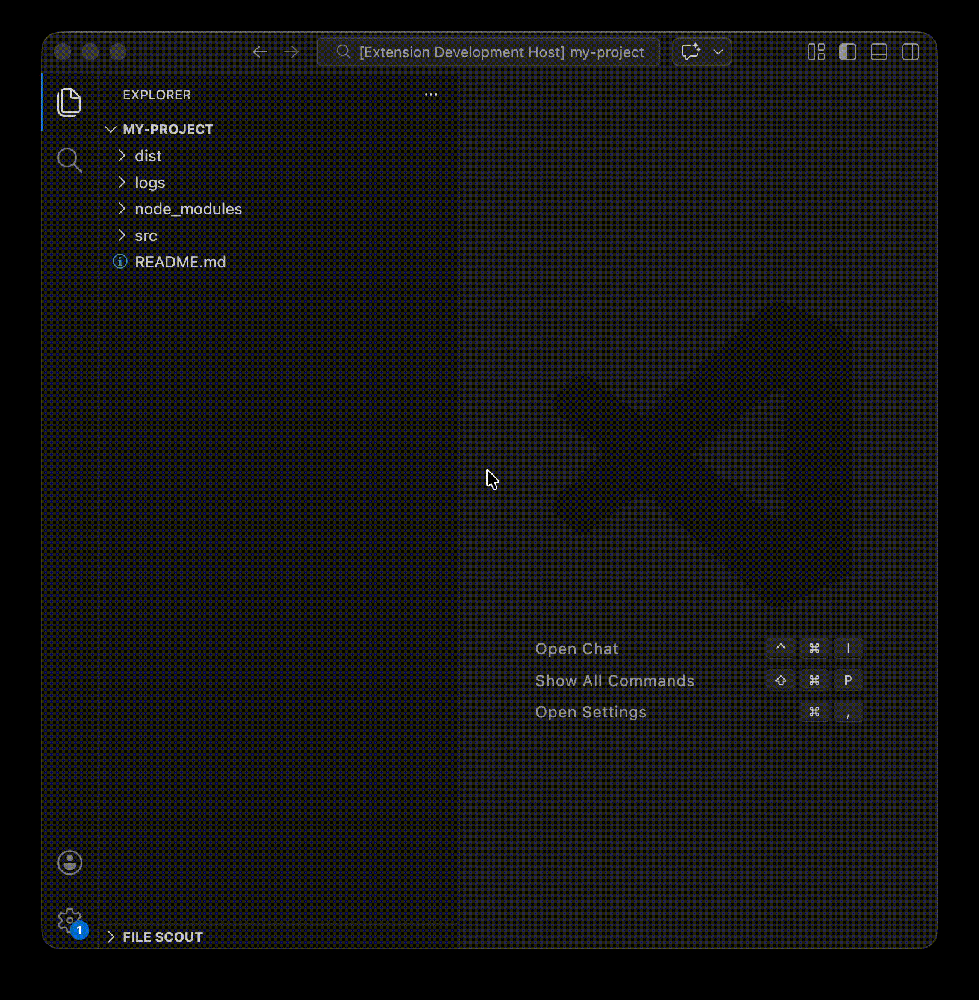

# File Scout 🔍

**Advanced search and intelligent filtering for files and folders in VS Code Explorer.**

File Scout is a powerful VS Code extension that enhances your file navigation experience with advanced search capabilities right in your Explorer sidebar. Find files and folders quickly with smart filtering options similar to VS Code's native search, but optimized specifically for file and folder discovery.



## ✨ Features

### 🎯 Advanced Search Options

Search by **filename or folder name** with mutually exclusive options:

- **Match Case (Aa)**: Case-sensitive search - find exactly what you're looking for
- **Match Whole Word (Ab)**: Match complete filenames before the extension
- **Regular Expression (.*)**: Use powerful regex patterns for complex searches

**Note:** Only one search option can be active at a time for precise control.

### 📁 Smart File & Folder Filtering

File Scout searches both files and folders intelligently:

- **Folder Matching**: When a folder matches your search, only files within that folder that also match are shown
- **Files to Include**: Specify patterns for which files to search (e.g., `**/*.ts`, `src/**`)
- **Files to Exclude**: Choose what to ignore with convenient checkboxes:
  - `node_modules/` ✓ (checked by default)
  - `dist/`
  - `build/`
  - `out/`
  - `.git/`
  - `.vscode/`
  - `coverage/`
  - `temp/, tmp/`
- **Custom Patterns**: Add your own glob patterns for fine-grained control
- **Expandable Filter Panel**: Click the three dots (⋯) to show/hide filter options

### 🌳 Flexible View Modes

Toggle between two visualization modes with a single click:

- **Tree View (🌳)**: Hierarchical folder structure with collapsible sections
- **List View (📄)**: Flat list of all results for quick scanning

### 📊 Results Counter

See at a glance how many items match your search:
- Displays count: "X files, Y folders"
- Updates automatically as you refine your search
- Shows both files and folders separately

### 🎨 Visual Enhancements

#### File Type Icons
Instantly recognize file types with intuitive icons and color-coded badges:
- TypeScript (TS), JavaScript (JS), JSX, TSX
- JSON, HTML, CSS, SCSS
- Markdown, Python, XML, SVG
- And many more!

#### Explorer Integration
- **File Decorations**: Matching files appear with a blue badge (●) in the VS Code Explorer
- **Instant Sync**: Decorations update automatically as search results change
- **Visual Feedback**: Quickly identify matching files across your entire workspace

### 📝 Export to Editor

Click **📝 Open in Editor** to export all search results to a new markdown document:
- Beautiful formatted list of all matching files and folders
- Includes search query and result count
- Perfect for documentation or sharing with team members

### ⚡ Quick Navigation

- **Click to Open**: Click any file in results to open it instantly
- **Reveal Folder**: Click folder names to reveal them in the Explorer
- **Keyboard Shortcuts**:
  - **Mac:** Option+Command+C: Toggle Match Case
  - **Mac:** Option+Command+W: Toggle Match Whole Word
  - **Mac:** Option+Command+R: Toggle Regular Expression
  - **Windows/Linux:** Ctrl+Alt+C: Toggle Match Case
  - **Windows/Linux:** Ctrl+Alt+W: Toggle Match Whole Word
  - **Windows/Linux:** Ctrl+Alt+R: Toggle Regular Expression

### 💾 Persistent State

Your search state is automatically preserved:
- Search query and results remain when collapsing/expanding the panel
- Active options (Match Case, Regex, etc.) are remembered
- Filter patterns persist across sessions
- No need to re-run searches when returning to File Scout

## 🚀 Getting Started

1. **Install File Scout** from the VS Code Marketplace
2. Open the **Explorer** sidebar (⌘/Ctrl + Shift + E)
3. Look for the **File Scout** panel
4. Start typing to search for files and folders!

## 💡 Usage Examples

### Basic Search
Type any text to find files or folders matching that pattern:
```
component → finds MyComponent.ts, LoginComponent.tsx, components/ folder
test → finds test.ts files AND test/ folders
```

### Pattern Matching
Use glob patterns for specific file types:
```
*.test → finds all test files
config.* → finds config.json, config.ts, etc.
**/*.tsx → finds all React TypeScript files
```

### Regular Expressions
Enable regex mode for powerful searches:
```
^index → files/folders starting with "index"
\.(ts|js)$ → all TypeScript or JavaScript files
controller → any file or folder containing "controller"
```

### Exclude Filters
Quickly exclude common folders with one click (node_modules excluded by default):
```
Custom pattern: **/*.test.ts → exclude all test files
Custom pattern: **/dist/** → exclude distribution folders
```

## 🎯 Why File Scout?

- **Files AND Folders**: Search both files and folders, not just content
- **Always Visible**: Integrated into the Explorer sidebar for instant access
- **Smart Filtering**: Pre-configured exclude patterns + intelligent folder matching
- **Simple UI**: Clean, VS Code-native design with tree and list views
- **Lightning Fast**: Optimized for quick file discovery with real-time results
- **Export Results**: Save search results to markdown for documentation
- **Persistent State**: Never lose your search when switching views

## ⚙️ Requirements

- Visual Studio Code version 1.109.0 or higher

## 🐛 Known Issues

- Maximum 2000 files displayed in search results (performance optimization)

## 📝 Release Notes

### 0.0.1 - Initial Release

**Search & Filtering**
- Advanced search for both files and folders
- Match Case, Match Whole Word, and Regex support (mutually exclusive)
- Smart file filtering with include/exclude patterns
- Quick-access checkboxes for common excluded folders (node_modules by default)
- Intelligent folder matching (shows only matching files within matching folders)

**Visualization**
- Tree view with hierarchical folder structure
- List view for flat result scanning
- One-click toggle between views (🌳/📄)
- File type icons with color-coded badges
- Results counter showing file and folder counts

**Integration**
- File decorations in VS Code Explorer (blue badge for matches)
- Click to open files or reveal folders in Explorer
- Export results to markdown editor
- Persistent state when collapsing/expanding panel

**User Experience**
- Keyboard shortcuts for all search options (Alt+C, Alt+W, Alt+R)
- Expandable filter panel with three-dot toggle
- Real-time search with debouncing
- Smooth animations and transitions

## 🤝 Contributing

Found a bug or have a feature request? Please open an issue on our [GitHub repository](https://github.com/marabunta-labs/file-scout).

## 📄 License

This extension is licensed under the MIT License.

---

**Enjoy File Scout!** 🎉

Made with ❤️ by **[Marabunta Labs](https://github.com/marabunta-labs)**.

